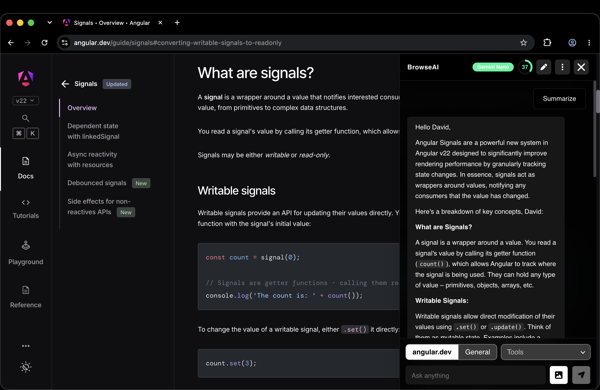
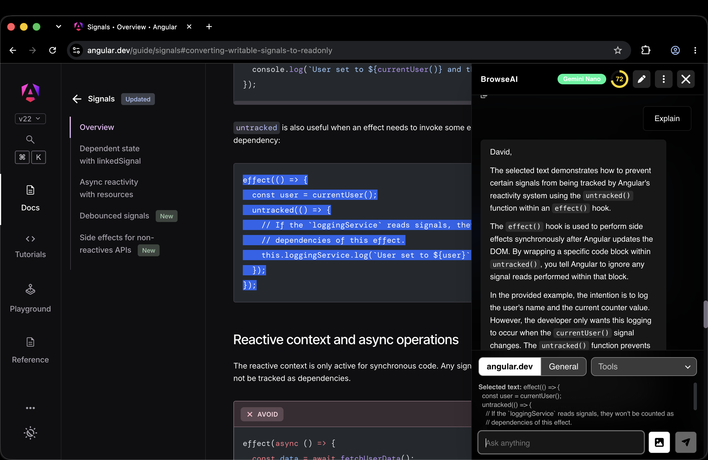
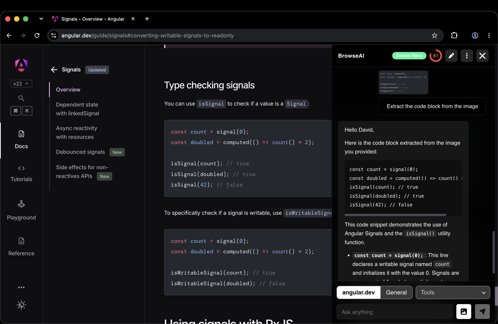
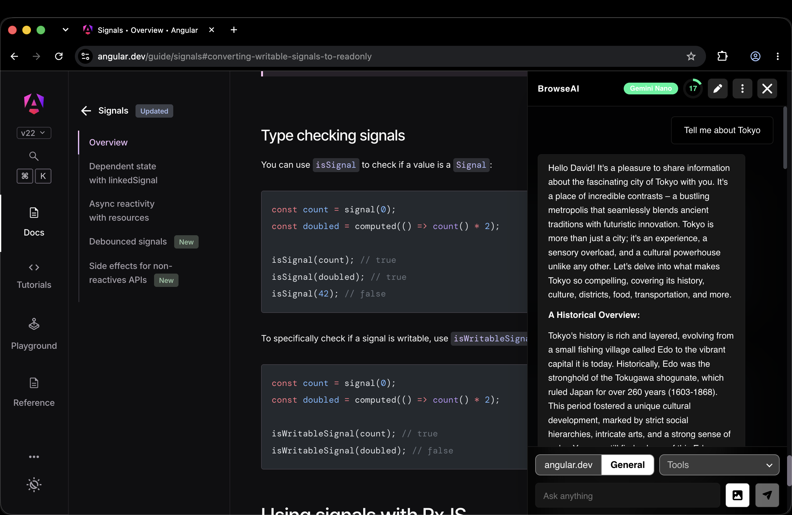
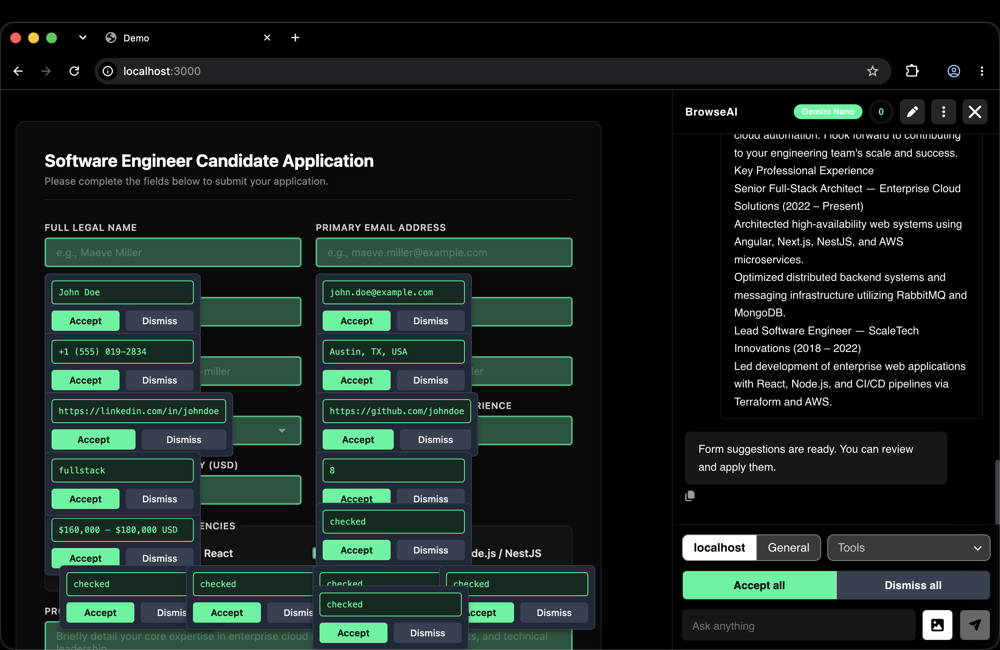

# browse-ai-core

[](https://www.npmjs.com/package/browse-ai-core)
[](LICENSE)

[](https://youtu.be/c3ZOUwcaTu0)

Watch the [demo on YouTube](https://youtu.be/c3ZOUwcaTu0).

To try it without writing code, install the
[BrowseAI extension](https://chromewebstore.google.com/detail/browseai/dgbhpfghmnipbilehfelfliihmgombch)
from the Chrome Web Store. It's built on this package.

A chat assistant you can add to any web page. It answers questions about the
page it's on, reads images and audio, fills forms, and pulls tables out of the
page. By default it uses the model built into Chrome (Gemini Nano through the
Prompt API), so nothing is sent to a server. You can plug in a different
model if you need to.

It works in Angular, React, Vue and plain HTML. In Angular it's a normal
standalone component. Everywhere else it's a `<browse-ai-core>` custom
element, with small wrappers for React and Vue.

The UI fits phones, tablets and desktops, has light and dark mode, and comes
with 10 color palettes.

## Browser support

The default model needs desktop Chrome with the built-in AI model available.
On first use the chat shows a button to download the model, which needs about
2 GB of disk space. In other browsers the chat shows a message that AI isn't
supported, unless you pass your own
[`aiProvider`](#using-a-different-model).

## Installation

```console
npm i browse-ai-core
```

## Usage

### Angular

Angular 22 or newer. Import the component:

```ts
import { Component, signal } from '@angular/core'
import type { MessageSentEvent } from 'browse-ai-core'
import { BrowseAiCoreComponent } from 'browse-ai-core/angular'

@Component({
  selector: 'app-root',
  imports: [BrowseAiCoreComponent],
  templateUrl: './app.html'
})
export class App {
  readonly open = signal(false)

  onMessageSent(event: MessageSentEvent): void {
    console.log('User asked:', event.text)
  }
}
```

```html
<button type="button" (click)="open.set(true)">Ask AI</button>

<browse-ai-core
  theme="system"
  position="bottom-right"
  [config]="{ strings: { title: 'Help' } }"
  [(open)]="open"
  (messageSent)="onMessageSent($event)"
/>
```

To set defaults for every chat in the app, use `provideBrowseAiCore`. The
component's own inputs are applied on top:

```ts
import { bootstrapApplication } from '@angular/platform-browser'
import { provideBrowseAiCore } from 'browse-ai-core/angular'

bootstrapApplication(App, {
  providers: [
    provideBrowseAiCore({
      palette: 'ocean',
      ai: { systemPrompt: 'Answer in short sentences.' }
    })
  ]
})
```

### React

React 19 or newer:

```tsx
import { useState } from 'react'
import { BrowseAiCore } from 'browse-ai-core/react'

const config = { palette: 'forest' as const, features: { bookmarks: false } }

function App() {
  const [open, setOpen] = useState(false)

  return (
    <>
      <button onClick={() => setOpen(true)}>Ask AI</button>

      <BrowseAiCore
        config={config}
        theme="system"
        open={open}
        onOpenChange={setOpen}
        onResponseReceived={(event) => console.log('Answer:', event.text)}
      >
        <p slot="empty-state">Ask me about this page.</p>
      </BrowseAiCore>
    </>
  )
}
```

Keep `config` outside the component or wrap it in `useMemo`, so a new object
isn't passed on every render. The component is marked `'use client'` and needs
a browser, so in Next.js use it in a client component.

### Vue

Vue 3.5 or newer. `v-model:open` works:

```vue
<script setup>
import { ref } from 'vue'
import { BrowseAiCore } from 'browse-ai-core/vue'

const open = ref(false)
const config = {
  palette: 'violet',
  strings: { inputPlaceholder: 'Ask about this page' }
}
</script>

<template>
  <button @click="open = true">Ask AI</button>

  <BrowseAiCore
    v-model:open="open"
    :config="config"
    theme="dark"
    @message-sent="(event) => console.log('User asked:', event.text)"
  />
</template>
```

If you'd rather use the `<browse-ai-core>` tag directly in templates, import
`browse-ai-core/element` and tell Vue it's a custom element:

```js
vue({
  template: {
    compilerOptions: { isCustomElement: (tag) => tag === 'browse-ai-core' }
  }
})
```

### Plain HTML

No build step needed. Load the element from a CDN:

```html
<script
  type="module"
  src="https://cdn.jsdelivr.net/npm/browse-ai-core@0.2/element/browse-ai-core.js"
></script>

<browse-ai-core
  theme="system"
  palette="sunset"
  position="bottom-left"
></browse-ai-core>

<script type="module">
  const chat = document.querySelector('browse-ai-core')
  chat.config = {
    strings: { title: 'Help' },
    features: { audioInput: false }
  }
  chat.addEventListener('responseReceived', (event) => {
    console.log('Answer:', event.detail.text)
  })
</script>
```

The same file is on unpkg:
`https://unpkg.com/browse-ai-core@0.2/element/browse-ai-core.js`. With a
bundler, `import 'browse-ai-core/element'` does the same thing.

The element bundle includes its own copy of Angular (about 115 kB gzipped).
In Angular apps use `browse-ai-core/angular` instead, which uses your app's
Angular.

## Options

`theme`, `palette`, `position` and `mode` are also inputs (attributes on the
element). They're shortcuts for the same keys in `config`. When both are set,
the input wins.

| Name                 | Type                                                           | Default            | Description                                                                        |
| -------------------- | -------------------------------------------------------------- | ------------------ | ---------------------------------------------------------------------------------- |
| `theme`              | `'light' \| 'dark' \| 'system'`                                | `'system'`         | `system` follows the operating system and changes with it.                         |
| `palette`            | see [palettes](#palettes)                                      | `'indigo'`         | Color palette.                                                                     |
| `position`           | `'bottom-right' \| 'bottom-left' \| 'top-right' \| 'top-left'` | `'bottom-right'`   | Corner for the button and the panel.                                               |
| `mode`               | `'floating' \| 'drawer' \| 'inline'`                           | `'floating'`       | See [layout](#layout).                                                             |
| `defaultContextMode` | `'page' \| 'general'`                                          | `'page'`           | Where the "Page / General" switch starts. `general` sends no page context.         |
| `features`           | `Partial<BrowseAiCoreFeatures>`                                | see below          | Turns parts of the UI on and off.                                                  |
| `ai`                 | `BrowseAiCoreAiOptions`                                        | `{}`               | Model options, see [AI options](#ai-options).                                      |
| `strings`            | `Partial<BrowseAiCoreStrings>`                                 | English            | Any text in the UI, see [text](#text-and-translation).                             |
| `aiProvider`         | `AiProvider`                                                   | Chrome's model     | See [using a different model](#using-a-different-model).                           |
| `storage`            | `StorageAdapter`                                               | see below          | Where settings and bookmarks are saved, see [storage](#storage).                   |
| `screenCapture`      | `ScreenCaptureAdapter \| null`                                 | see below          | How screenshots are taken. `null` turns screenshots off.                           |
| `storageKey`         | `string`                                                       | `'browse-ai-core'` | Key used in storage. Give two chats on one site different keys to keep them apart. |

The `open` input (a property on the element) opens and closes the panel. In
Angular use `[(open)]`, in Vue `v-model:open`, in React `open` with
`onOpenChange`.

### Features

All of them are on by default, except `domToComponent` and `bookmarks`.

| Name               | Description                                                                                |
| ------------------ | ------------------------------------------------------------------------------------------ |
| `pageContext`      | "Page / General" switch. When off, prompts never include the page.                         |
| `imageInput`       | Upload an image from the attachment menu.                                                  |
| `audioInput`       | Upload an audio file from the attachment menu.                                             |
| `screenCapture`    | "Capture visible area" and "Snip and capture" in the attachment menu.                      |
| `formFiller`       | Tool that suggests values for the form on the page. Each one can be accepted or not.       |
| `tablesExtractor`  | Tool that reads the tables on the page and downloads them as CSV, Excel, JSON or Markdown. |
| `domToComponent`   | Tool that turns an element you click on the page into Angular, React or Vue code.          |
| `summarizer`       | Tool that summarizes text with Chrome's Summarizer API.                                    |
| `translator`       | Tool that translates text with Chrome's Translator API, to a language picked in the chat.  |
| `writer`           | Tool that writes text for a task with Chrome's Writer API.                                 |
| `rewriter`         | Tool that rewrites text with Chrome's Rewriter API.                                        |
| `proofreader`      | Tool that fixes grammar and spelling with Chrome's Proofreader API.                        |
| `selectionActions` | Summarize, Translate and other buttons next to text the user selects on the page.          |
| `imageDownloader`  | Tool that checks the images on the screen for a subject and downloads the matches as zip.  |
| `subjectFinder`    | Tool that finds the part of the page the user describes and scrolls to it.                 |
| `bookmarks`        | Saves every page you open into a category picked by the model.                             |
| `settings`         | Settings panel.                                                                            |
| `personalization`  | Nickname and custom instructions in settings. They're added to every prompt.               |
| `appearance`       | Theme and palette pickers in settings. The user's choice wins over `theme` and `palette`.  |
| `markdown`         | Shows answers as Markdown. When off, answers are plain text.                               |
| `contextUsage`     | Round badge in the header that shows how much of the model's memory is used.               |

```js
chat.config = {
  features: { formFiller: false, tablesExtractor: false, settings: false }
}
```

## Styling

### Light and dark mode

`theme: 'system'` follows `prefers-color-scheme`. Use `'light'` or `'dark'` to
fix it. If `features.appearance` is on, users can change it in settings and
their choice is saved.

### Palettes

`indigo`, `ocean`, `forest`, `sunset`, `rose`, `violet`, `amber`, `slate`,
`teal` and `crimson`. Each one has a light and a dark version, and all text in
them has a contrast ratio of at least 4.5:1 (WCAG AA). The list is exported as
`PALETTE_NAMES`.

### CSS variables

Every color is a CSS variable. Set them on the element to change a palette or
make your own. They apply in both modes, so put dark mode values in a media
query if you need them:

```css
browse-ai-core {
  --bac-primary: #0f766e;
  --bac-primary-hover: #115e59;
  --bac-radius: 12px;
  --bac-panel-width: 440px;
}

@media (prefers-color-scheme: dark) {
  browse-ai-core {
    --bac-primary: #2dd4bf;
  }
}
```

Colors:

| Variable              | Used for                                         |
| --------------------- | ------------------------------------------------ |
| `--bac-bg`            | Panel background                                 |
| `--bac-surface`       | Answers, cards, inputs                           |
| `--bac-surface-hover` | Hovered buttons and rows                         |
| `--bac-border`        | Borders                                          |
| `--bac-text`          | Text                                             |
| `--bac-text-muted`    | Secondary text and placeholders                  |
| `--bac-primary`       | Launcher, send button, user messages, focus ring |
| `--bac-primary-hover` | Hovered primary buttons                          |
| `--bac-on-primary`    | Text and icons on primary                        |
| `--bac-accent-soft`   | Tool help box and selected options               |
| `--bac-accent-text`   | Text on `--bac-accent-soft`                      |
| `--bac-success`       | Success text and borders                         |
| `--bac-success-soft`  | Success background                               |
| `--bac-warning`       | Warning text and borders                         |
| `--bac-warning-soft`  | Warning background                               |
| `--bac-danger`        | Error text and borders                           |
| `--bac-danger-soft`   | Error background                                 |

The moving glow behind the header and the messages while the model is
thinking uses its own colors. Each palette sets them for light and dark mode:

| Variable                                                               | Used for                                                                           |
| ---------------------------------------------------------------------- | ---------------------------------------------------------------------------------- |
| `--bac-thinking1`, `--bac-thinking2`, `--bac-thinking3`                | The three glow colors                                                              |
| `--bac-thinking1-deep`, `--bac-thinking2-soft`, `--bac-thinking3-soft` | Darker shades of them for the second layer                                         |
| `--bac-thinking-surface`                                               | Background of the header and messages while the glow shows                         |
| `--bac-thinking-blend`                                                 | Blend mode of the second layer (`screen` in dark mode, `soft-light` in light mode) |

Sizes:

| Variable              | Default      | Description                                 |
| --------------------- | ------------ | ------------------------------------------- |
| `--bac-font-family`   | system font  | Font of the whole chat                      |
| `--bac-radius`        | `0.5rem`     | Corner radius. The panel uses twice this.   |
| `--bac-offset`        | `16px`       | Distance from the edge of the window        |
| `--bac-panel-width`   | `400px`      | Panel width in `floating` and `drawer` mode |
| `--bac-panel-height`  | `640px`      | Panel height in `floating` mode             |
| `--bac-launcher-size` | `56px`       | Size of the round button                    |
| `--bac-z-index`       | `2147483000` | Stacking order of the button and the panel  |

### Parts

The chat is in a shadow root, so page styles don't change it and its styles
don't leak out. To style one piece of it directly, use `::part()`:

```css
browse-ai-core::part(launcher) {
  box-shadow: none;
}

browse-ai-core::part(message-user) {
  border-radius: 16px 16px 4px 16px;
}
```

Parts: `launcher`, `panel`, `header`, `messages`, `message-user`,
`message-assistant`, `message-error`, `composer`, `input`, `send-button`,
`stop-button`, `attach-button`, `menu`, `listbox` and `toast`.

### Layout

- `floating`: a round button in the corner opens a panel next to it.
- `drawer`: the same button, but the panel takes the full height of the window
  on the left or right side, depending on `position`.
- `inline`: no round button and no close button. The chat fills the element
  it's in, so give that element a height.

On screens narrower than 640px, `floating` and `drawer` panels cover the whole
screen and leave room for the notch on phones. Buttons get bigger on touch
screens. Esc closes the panel, and while it covers the screen, Tab stays inside
it.

Floating and drawer panels use `position: fixed`. If you put the element inside
something with a `transform` or `filter`, the panel is positioned relative to
that element instead of the window.

## Your own markup

Put elements with a `slot` attribute inside the chat to replace or add parts of
the UI:

| Slot            | Where                                                    |
| --------------- | -------------------------------------------------------- |
| `launcher-icon` | Icon inside the round button. Replaces the default icon. |
| `header`        | Before the title in the header, for example a logo.      |
| `empty-state`   | Shown before the first message. Replaces the default.    |
| `footer`        | Bottom of the panel, under the input.                    |

```html
<browse-ai-core>
  
  <p slot="empty-state">Ask about our plans and prices.</p>
  <small slot="footer">Answers can be wrong. Check important details.</small>
</browse-ai-core>
```

In Angular put the same elements inside `<browse-ai-core>`. In React and Vue
pass them as children. Slot content is read once when the chat starts, so use
static content.

## AI options

```js
chat.config = {
  ai: {
    systemPrompt:
      'You are the help assistant of Acme. Answer in short sentences.',
    temperature: 0.4,
    topK: 3,
    outputLanguage: 'en',
    initialPrompts: [
      { role: 'user', content: 'What do you sell?' },
      { role: 'assistant', content: 'Garden tools.' }
    ]
  }
}
```

| Name             | Type                  | Description                                                                     |
| ---------------- | --------------------- | ------------------------------------------------------------------------------- |
| `systemPrompt`   | `string`              | Instructions sent to the model before every conversation.                       |
| `temperature`    | `number`              | Randomness of the answers. Chrome needs `topK` with it.                         |
| `topK`           | `number`              | How many words the model picks from at each step.                               |
| `outputLanguage` | `string`              | Language of the answers. Default `'en'`.                                        |
| `initialPrompts` | `AiPromptMessage[]`   | Example messages the conversation starts with.                                  |
| `builtInTools`   | `BuiltInToolsOptions` | Options for the Summarizer, Translator, Writer, Rewriter and Proofreader tools. |

`builtInTools` is passed to each API's `create()` call:

```js
chat.config = {
  ai: {
    builtInTools: {
      summarizer: { type: 'key-points', length: 'short' },
      translator: { targetLanguage: 'de' },
      writer: { tone: 'formal' },
      rewriter: { tone: 'more-casual' },
      proofreader: { expectedInputLanguages: ['en'] }
    }
  }
}
```

Defaults are in `DEFAULT_BUILT_IN_TOOLS`. The Translator detects the language
of the text with `LanguageDetector` when its model is ready, and uses English
otherwise. Set `translator.sourceLanguage` to fix it.

When the page is too long for the model, the chat cuts the page text, tries
again, and tells the user how much was cut.

### Checking support

`isAiSupported()` tells if the AI features work on this device. It runs the
same check as the chat, which shows "AI features are not supported in this
browser." when it fails. Pass the same config as the chat.

```js
import { getAiAvailability, isAiSupported } from 'browse-ai-core'

if (await isAiSupported(config)) showAskAiButton()

// 'available', 'downloadable', 'downloading' or 'unavailable'
const availability = await getAiAvailability(config)
```

### Using a different model

Pass an object with `availability` and `createSession`. This one sends the
prompt to your own backend:

```ts
import type { AiProvider } from 'browse-ai-core'

const myProvider: AiProvider = {
  name: 'My model',
  async availability() {
    return 'available'
  },
  async createSession(options) {
    const history: { role: string; content: unknown }[] = []
    if (options?.systemPrompt)
      history.push({ role: 'system', content: options.systemPrompt })

    return {
      async prompt(input, { signal } = {}) {
        history.push({ role: 'user', content: input })
        const response = await fetch('/api/chat', {
          method: 'POST',
          headers: { 'Content-Type': 'application/json' },
          body: JSON.stringify({ messages: history }),
          signal
        })
        const { text } = await response.json()
        history.push({ role: 'assistant', content: text })
        return text
      }
    }
  }
}

chat.config = { aiProvider: myProvider }
```

`input` is a string, or a list of messages when the user attached an image or
audio. To stream the answer, add `promptStreaming(input, { signal })` that
returns an async iterable (or a `ReadableStream`) of text chunks. To fill the
memory badge, set `contextUsage` and `contextWindow` on the session.

`chromeLanguageModelProvider()` is the default provider. It's exported in case
you want to wrap it.

## Storage

Settings, personalization and bookmarks are saved as one JSON value under
`storageKey`. The default is `chrome.storage.local` inside a browser extension,
then `localStorage`, then memory.

To save them somewhere else, pass an object with `get`, `set` and `remove`:

```ts
import type { StorageAdapter } from 'browse-ai-core'

const serverStorage: StorageAdapter = {
  async get(key) {
    const response = await fetch(`/api/settings/${key}`)
    return response.ok ? response.json() : undefined
  },
  async set(key, value) {
    await fetch(`/api/settings/${key}`, {
      method: 'PUT',
      body: JSON.stringify(value)
    })
  },
  async remove(key) {
    await fetch(`/api/settings/${key}`, { method: 'DELETE' })
  }
}
```

`localStorageAdapter()`, `memoryStorageAdapter()` and `chromeStorageAdapter()`
are exported too.

## Screenshots

On a normal web page, screenshots use `getDisplayMedia`, so the browser asks
the user to share the tab first. In a browser extension the chat sends
`{ type: 'CAPTURE_VISIBLE_TAB' }` to the background worker, which should answer
with `{ ok: true, dataUrl }` from `chrome.tabs.captureVisibleTab`.

To take screenshots another way, pass a `screenCapture` object with a
`captureVisibleArea()` method that returns a PNG data URL. Pass `null` to hide
the screenshot options.

## Text and translation

Every text in the UI can be changed. Pass only the ones you need:

```js
chat.config = {
  strings: {
    title: 'Asistente',
    openChat: 'Abrir chat',
    inputPlaceholder: 'Pregunta lo que quieras',
    send: 'Enviar'
  },
  ai: { outputLanguage: 'es' }
}
```

Words in braces are filled in at runtime, for example
`contextUsage: '{percent}% of chat memory used'`. The full list with the
English defaults is exported as `DEFAULT_STRINGS`.

## Events

| Angular / element  | React                | Vue                | Payload                                            |
| ------------------ | -------------------- | ------------------ | -------------------------------------------------- |
| `opened`           | `onOpened`           | `opened`           | none                                               |
| `closed`           | `onClosed`           | `closed`           | none                                               |
| `openChange`       | `onOpenChange`       | `update:open`      | `boolean`                                          |
| `messageSent`      | `onMessageSent`      | `messageSent`      | `{ text, hasImage, hasAudio }`                     |
| `responseReceived` | `onResponseReceived` | `responseReceived` | `{ text }`                                         |
| `errorOccurred`    | `onError`            | `error`            | `Error`                                            |
| `themeChange`      | `onThemeChange`      | `themeChange`      | `{ theme, mode }`, where `mode` is the mode in use |

On the element, the payload is in `event.detail`.

## Browser extensions

Chrome content scripts can't define custom elements, so use the Angular
component there and mount it yourself. The
[BrowseAI extension](https://github.com/davidmarjanidze/browse-ai) does it like
this:

```ts
import { createComponent } from '@angular/core'
import { createApplication } from '@angular/platform-browser'
import {
  BrowseAiCoreComponent,
  provideBrowseAiCore
} from 'browse-ai-core/angular'

const host = document.createElement('browse-ai-core')
document.body.appendChild(host)

const app = await createApplication({
  providers: [
    provideBrowseAiCore({ mode: 'drawer', features: { bookmarks: true } })
  ]
})
const chat = createComponent(BrowseAiCoreComponent, {
  environmentInjector: app.injector,
  hostElement: host
})
app.attachView(chat.hostView)
```

## Demo screenshots











## Docs

Architecture, decisions and the development and release steps are in
[docs/](docs/README.md).

## License

[MIT](LICENSE)
